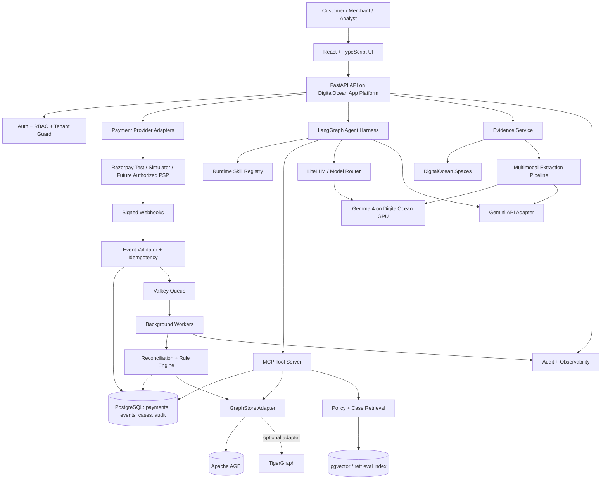
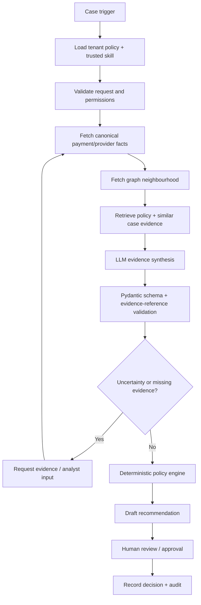

# ResolveX AI — Product Requirements Document

**Product:** ResolveX AI  
**Subtitle:** Agentic Payment Intelligence, Fraud Investigation & Resolution Platform  
**Document type:** Product Requirements Document + Implementation Specification  
**Version:** 1.0  
**Status:** Hackathon build baseline / implementation-ready draft  
**Date:** 31 October 2026  
**Primary implementation agent:** Google Antigravity  

> **Product promise:** Turn fragmented payment signals into verified payment timelines, explainable fraud investigations, and human-approved resolution workflows.

---

## 1. Executive summary

ResolveX AI is a two-track financial operations platform:

1. **Payment issue resolution:** ingest payment-provider events, normalize payment and refund states, reconcile conflicting records, maintain an auditable timeline, and help customers and merchant support teams resolve pending, failed, reversed, or disputed payments.
2. **Graph-based fraud investigation:** connect related transactions, tokenized customers, merchants, devices, payment references, and prior cases; detect suspicious networks; gather supporting evidence; and produce explainable investigation recommendations for analysts.

Both tracks share a common case-management layer, evidence store, agent orchestration harness, policy engine, audit trail, and dashboard. Multimodal intake lets a user submit a receipt screenshot, payment notification, PDF statement, or voice explanation. The model extracts *claims* from that material; provider APIs and authorized records remain the authority for actual payment status.

The solution combines open-weight inference using **Gemma 4**, optional advanced processing using the **Gemini API**, open Agent Skills, an open agent harness, MCP tool interfaces, and a DigitalOcean deployment. The model, graph store, and payment provider are accessed through replaceable adapters so the product is not locked to one vendor.

**Core safety principle:** an LLM may interpret, summarize, classify, and recommend. It must not invent a bank status, declare a refund complete without an authoritative event, approve a fraud action, or execute an irreversible financial operation.

## 2. Product need and problem statement

### 2.1 Current problem

Payment support and fraud teams often work across disconnected payment gateway dashboards, bank/PSP messages, merchant order systems, spreadsheets, email, and support tickets. That creates several gaps:

- A payer may report that their account was debited while the merchant order still appears unpaid.
- Payment, reversal, and refund states may be delayed or represented differently by different providers.
- Support teams manually compare transaction IDs, timestamps, amounts, order references, and provider events.
- Fraud signals may be distributed across many transactions, accounts, merchants, devices, and payment instruments. A single-transaction score can miss the connected pattern.
- Customer-submitted screenshots or PDFs can contain useful evidence but require careful extraction and verification.
- Analysts need an auditable explanation of which records support a conclusion and which facts remain uncertain.

### 2.2 Product need

ResolveX AI should give users one operational workspace to:

- See a canonical, timestamped payment journey.
- Distinguish provider-confirmed facts from customer-reported claims and model-extracted information.
- Identify mismatches, missing events, delayed refunds, and unusual transaction patterns.
- Investigate connected entities using graph context and prior-case knowledge.
- Receive an evidence-linked explanation and a policy-compliant next step.
- Route sensitive or high-risk actions to a human reviewer and preserve the decision trail.

### 2.3 Why a combined product

Payment operations and fraud investigation are related but should not be collapsed into one score. Payment status answers **what happened to this payment?** Fraud investigation answers **is this payment or connected activity suspicious, and why?** A payment can be unsuccessful without being fraudulent, and a successful payment can still be suspicious. ResolveX AI therefore maintains separate payment, refund, dispute, and fraud states while sharing evidence and case context.

## 3. Vision, goals, metrics, and non-goals

### 3.1 Vision

Become an evidence-first financial operations assistant that reduces investigation effort while keeping payment truth, policy decisions, and sensitive actions under auditable human or provider control.

### 3.2 MVP goals

| ID | Goal | MVP success measure |
|---|---|---|
| G-01 | Track normalized payment states | Every ingested test transaction has an event timeline and a source label. |
| G-02 | Identify payment exceptions | Detect configured missing-event, amount-mismatch, duplicate-event, and delayed-refund scenarios in seeded tests. |
| G-03 | Investigate graph relationships | Show explainable paths connecting a flagged payment to related tokenized entities and transactions. |
| G-04 | Produce grounded AI findings | Every factual finding references one or more evidence IDs; unsupported claims are marked unknown. |
| G-05 | Support multimodal evidence | Extract candidate fields from receipt images/PDFs and voice notes, then request user confirmation for uncertain fields. |
| G-06 | Support safe resolution workflow | Create a case and recommendation draft; require authorized human approval for external or financial actions. |
| G-07 | Be provider/model portable | Switch between Gemma and Gemini via configuration/adapters without changing domain logic. |

### 3.3 Pilot metrics to instrument

Do not claim target performance until measured. Establish a baseline and report:

- Payment exception detection precision and recall on a labelled synthetic/test set.
- Fraud alert precision, recall, false-positive rate, and analyst override rate on a labelled test graph.
- Median and P95 time to produce a first investigation summary.
- Median analyst handling time versus a manual baseline.
- Percentage of AI findings with valid evidence references.
- Multimodal field extraction exact-match rate for amount, date/time, merchant, and reference number.
- Webhook acceptance, duplicate suppression, retry, and dead-letter counts.
- Provider/model request cost, latency, timeout rate, and fallback rate.

### 3.4 Out of scope for the hackathon MVP

- Direct login to a customer's bank account, scraping banking apps, or collecting bank passwords, OTPs, card PINs, CVVs, UPI PINs, or internet-banking credentials.
- Unauthorised access to bank/UPI internal systems or any promise of universal real-time access across every bank, PSP, or UPI app.
- Automatic refunds, chargebacks, payment reversals, account freezes, beneficiary blocks, account closures, or regulatory filings.
- A production-grade banking, lending, credit-scoring, AML, or regulatory decision system.
- Treating uploaded screenshots, OCR, LLM inference, or a heuristic risk score as authoritative bank or payment-provider confirmation.
- Using real personal financial data in the demo when synthetic/test data can demonstrate the workflow.

## 4. Users and user-requirement analysis

### 4.1 Personas

| Persona | Need / job to be done | Main actions | Success outcome |
|---|---|---|---|
| Payer / customer | Understand where a payment stands and what to do next. | Search a transaction, submit a reference, upload evidence, view status and case updates. | Clear status, source, uncertainty, and next step without sharing credentials. |
| Merchant support analyst | Resolve customer tickets quickly and consistently. | Search by order/payment ID, compare provider events, open cases, request evidence, draft a response. | Shorter handling time and a defensible case history. |
| Fraud analyst | Investigate suspicious transactions and connected entities. | Review alerts, expand graph paths, inspect evidence, compare prior cases, recommend escalation. | Explainable, evidence-backed investigations with fewer blind spots. |
| Operations supervisor | Control queues, review high-risk recommendations, and monitor patterns. | Assign cases, approve or reject recommendations, inspect audit logs and metrics. | Controlled operations and clear accountability. |
| Platform administrator / integrator | Configure provider adapters, model routes, roles, webhooks, and environment settings. | Add test credentials, configure endpoints, manage keys, view integration health. | Reliable integrations without exposing secrets to end users or the LLM. |

### 4.2 User stories

**Customer**
- As a customer, I can submit a payment/order reference and see the latest confirmed provider status and update time.
- As a customer, I can upload a receipt or payment screenshot; the system extracts candidate details and asks me to confirm uncertain fields.
- As a customer, I can see whether an amount or debit statement is provider-confirmed, customer-reported, or unverified.
- As a customer, I can view a case number, current owner/status, and recommended next step.

**Merchant support**
- As a support analyst, I can search by order ID, gateway payment ID, provider reference, or masked UPI reference.
- As a support analyst, I can see the full event timeline, duplicate events, status changes, refund events, and settlement discrepancies.
- As a support analyst, I can ask the agent for a concise, evidence-linked case summary and a customer-ready draft.
- As a support analyst, I can create and assign a case without allowing the model to execute a refund.

**Fraud analyst**
- As a fraud analyst, I can open a risk-triggered investigation and see related payments, merchants, devices, and tokenized identifiers.
- As a fraud analyst, I can inspect why each entity or edge is included and the source/time of the relationship.
- As a fraud analyst, I can see the model's recommendation separately from deterministic policy output and my final decision.
- As a fraud analyst, I can request additional evidence and record a disposition with an audit trail.

**Supervisor / administrator**
- As a supervisor, I can approve, reject, or return a proposed action for more evidence.
- As an administrator, I can configure model routing and disable external model calls for a tenant.
- As an administrator, I can inspect tool invocations, evidence provenance, model versions, and policy versions.

## 5. Product scope and user journeys

### 5.1 Track A — Payment issue resolution

1. A transaction is created in the demo simulator or payment-provider test environment.
2. The provider webhook/API supplies an event. The webhook endpoint validates the signature, stores the raw event safely, and acknowledges it quickly.
3. An asynchronous worker normalizes the provider status and appends an immutable payment event.
4. Reconciliation logic checks event sequence, amount/currency consistency, duplicate events, order mapping, refund state, and settlement records where available.
5. If a configured exception occurs, ResolveX opens or updates a payment case.
6. The payment-triage agent retrieves permitted records and policy material, produces a structured summary, marks uncertainty, and proposes next steps.
7. A support analyst reviews the case and sends/records an approved response or external follow-up. No automatic bank/refund action is performed in MVP.

### 5.2 Track B — Graph-based fraud investigation

1. A deterministic rule, provider alert, or analyst action creates a fraud investigation trigger.
2. The graph adapter queries related tokenized customers, payment instruments, merchants, devices, references, and recent transactions.
3. Graph analytics identify configured patterns such as many accounts sharing one device token, repeated low-value authorisation attempts, unusual transaction velocity, or a connected set of recently flagged cases.
4. GraphRAG retrieves versioned fraud policies, typology guidance, and previously closed synthetic/test cases.
5. The fraud-investigation agent assembles a provenance-tagged evidence bundle and assesses uncertainty.
6. The deterministic policy engine evaluates permitted actions and approval level. It does not rely on an LLM verdict alone.
7. An analyst reviews the graph, evidence, model rationale, policy outcome, and action draft; final disposition is recorded with user identity and timestamp.

### 5.3 Track C — Multimodal evidence intake

1. A user uploads a receipt image, screenshot, supported PDF, or voice note.
2. File validation checks MIME type, size, malware status, tenant ownership, and retention policy.
3. Text is extracted locally where feasible; Gemma 4 is used for image/audio-capable extraction when the selected model deployment supports the modality. Gemini API may be used for complex document understanding only when tenant policy and user consent permit it.
4. The extractor returns a strict JSON object with candidate fields, confidence, page/frame/segment references, and raw evidence references.
5. The UI shows extracted values for user confirmation. Low-confidence or conflicting fields remain unverified.
6. Confirmed candidate values are used as search hints. They do not overwrite provider-confirmed transaction status.

### 5.4 Core dashboard areas

- **Overview:** payment volume, unresolved cases, exceptions, fraud alerts, refund ageing, and queue status.
- **Payments:** searchable payments, normalized state, provider state, event timeline, refunds, and reconciliation details.
- **Investigations:** case queue, case detail, graph canvas, evidence panel, uncertainty, policy gate, and approval history.
- **Evidence:** uploaded files, extracted claims, provenance, confirmation status, and secure access log.
- **Agent activity:** skills selected, tools invoked, model/provider/version, latency, structured findings, and errors. Do not expose hidden chain-of-thought; show short rationale and evidence references only.
- **Admin:** users/roles, tenants, provider connections, webhook health, model configuration, policy versions, and audit exports.

## 6. Functional requirements

Priority: **P0** = must ship for MVP; **P1** = should ship if time permits; **P2** = post-hackathon.

| ID | Priority | Requirement | Acceptance criteria |
|---|---|---|---|
| FR-001 | P0 | Authentication and RBAC | Login works; customer, support, fraud analyst, supervisor, and admin permissions are enforced server-side. |
| FR-002 | P0 | Tenant isolation | Every case, payment, event, evidence object, graph query, and audit record is scoped to a tenant; cross-tenant tests fail closed. |
| FR-003 | P0 | Payment provider abstraction | A `PaymentProviderAdapter` interface supports simulator and Razorpay Test Mode; domain services do not call provider SDKs directly. |
| FR-004 | P0 | Secure webhook ingestion | Signature verified before processing; replay/idempotency key prevents duplicate event application; raw payload access is restricted. |
| FR-005 | P0 | Canonical payment model | Provider-specific states map to normalized states while raw provider status and source are retained. |
| FR-006 | P0 | Event timeline | Timeline is append-only and shows event time, received time, source, and status transition. |
| FR-007 | P0 | Payment reconciliation | Detect seeded amount mismatch, missing provider event, order/payment mismatch, duplicate event, and stale/pending status conditions. |
| FR-008 | P0 | Refund tracking | Show requested/pending/processed/failed/unknown from provider events or verified API response; never infer completion from a model answer. |
| FR-009 | P0 | Case management | Create, assign, update status, add notes/evidence, and close cases with an audit event. |
| FR-010 | P0 | Graph store abstraction | `GraphStore` interface supports an Apache AGE implementation and optional TigerGraph adapter; graph queries are typed and tenant-scoped. |
| FR-011 | P0 | Graph evidence view | Show nodes/edges and the source for each relationship; clicking a node filters related evidence and transactions. |
| FR-012 | P0 | Deterministic fraud rules | Configured velocity, shared-device, repeated-attempt, and connected-entity rules emit reproducible reason codes. |
| FR-013 | P0 | Agent workflow harness | LangGraph workflow uses typed state, checkpointing, bounded steps, timeout/retry policy, and explicit approval pause. |
| FR-014 | P0 | Runtime Agent Skills | Skill registry loads only reviewed, versioned skills from the application repository; each skill has a scoped tool allowlist. |
| FR-015 | P0 | MCP tool server | Expose typed, permission-checked read and draft tools; tools return source IDs and structured errors. |
| FR-016 | P0 | Provider-neutral model interface | Gemma and Gemini adapters implement a common capability-aware interface; model switch is configuration-driven. |
| FR-017 | P0 | Structured AI findings | Pydantic-validated output includes summary, findings, evidence IDs, confidence/uncertainty, unknowns, recommended next step, and required approval. |
| FR-018 | P0 | Evidence provenance | Every model finding must cite evidence IDs; unsupported claims are marked `unknown` or rejected by validator. |
| FR-019 | P0 | Multimodal upload | Accept image/PDF/audio within configured limits; show extracted candidate fields and require user confirmation for uncertain data. |
| FR-020 | P0 | Human approval gate | External or financially sensitive action drafts remain pending until an authorized user approves; approval is recorded separately from the agent recommendation. |
| FR-021 | P0 | Immutable audit trail | Log actor, tenant, case, action, timestamp, policy/model/skill version, tool call IDs, approval result, and relevant evidence IDs. |
| FR-022 | P0 | Synthetic demo data | Include deterministic scenario generator for success, pending, failed, debit-reported mismatch, refund delay, duplicate webhook, and linked fraud network. |
| FR-023 | P1 | Notification updates | Send in-app/email notification for case state changes using a mock or sandbox provider. |
| FR-024 | P1 | Case memory / GraphRAG | Retrieve versioned policy chunks and closed test cases with provenance metadata. |
| FR-025 | P1 | Model evaluation console | Compare Gemma/Gemini results on fixed extraction and investigation test sets. |
| FR-026 | P2 | Authorized financial-data integration | Add only after institutional/provider agreements, consent flow, legal review, and API access are in place. |

## 7. Domain model and status semantics

### 7.1 Separate status dimensions

Do not compress all payment information into one ambiguous status. Store independent fields:

- `payment_status`: `CREATED`, `INITIATED`, `PENDING`, `SUCCEEDED`, `FAILED`, `EXPIRED`, `REVERSED`, `UNKNOWN`.
- `funds_status`: `NOT_REPORTED`, `CUSTOMER_REPORTED_DEBIT`, `PROVIDER_CONFIRMED_DEBIT`, `PROVIDER_CONFIRMED_CREDIT`, `UNKNOWN`.
- `refund_status`: `NOT_APPLICABLE`, `NOT_INITIATED`, `REQUESTED`, `PENDING`, `PROCESSED`, `FAILED`, `UNKNOWN`.
- `settlement_status`: `NOT_APPLICABLE`, `PENDING`, `SETTLED`, `MISMATCH`, `UNKNOWN`.
- `case_status`: `NEW`, `TRIAGING`, `AWAITING_EVIDENCE`, `REVIEW_REQUIRED`, `ESCALATED`, `RESOLVED`, `CLOSED`.
- `fraud_severity`: `NONE`, `LOW`, `MEDIUM`, `HIGH`, `CRITICAL`.

A customer statement or uploaded bank screenshot may set `funds_status=CUSTOMER_REPORTED_DEBIT`, not `PROVIDER_CONFIRMED_DEBIT`. The status source and timestamp must always be visible.

### 7.2 Core entities

| Entity | Key fields |
|---|---|
| Tenant | id, name, settings, data-retention policy |
| User | id, tenant_id, role, status, authentication metadata |
| Merchant | id, tenant_id, external_ref, display_name |
| Payment | id, tenant_id, merchant_id, order_ref, provider, provider_payment_id, amount_minor, currency, payment_status, funds_status, created_at |
| PaymentEvent | id, payment_id, provider_event_id, event_type, raw_status, normalized_status, source, event_time, received_at, payload_hash, idempotency_key |
| Refund | id, payment_id, provider_refund_id, amount_minor, refund_status, requested_at, updated_at |
| SettlementRecord | id, merchant_id, provider, settlement_ref, amount_minor, currency, settlement_status, settlement_time |
| Case | id, tenant_id, case_type, linked_payment_ids, priority, case_status, owner_id, created_at, updated_at |
| EvidenceAsset | id, tenant_id, case_id, storage_key, mime_type, hash, source_type, scan_status, retention_until |
| EvidenceClaim | id, evidence_asset_id, field_name, candidate_value, confidence, verification_state, source_location |
| InvestigationFinding | id, case_id, finding_type, severity, explanation, evidence_ids, rule_id, model_run_id |
| Approval | id, case_id, action_draft, requested_by, reviewed_by, decision, reason, timestamp |
| AgentRun | id, case_id, workflow, skill_versions, model_provider, model_id, prompt_version, tool_trace_ids, status, latency_ms |
| AuditEvent | id, tenant_id, actor_id, action, resource_type, resource_id, timestamp, metadata_hash |

Store monetary amounts as integer minor units (paise) and currency as ISO code. Do not use floating-point arithmetic for money.

### 7.3 Graph schema

**Vertices:** `CustomerToken`, `Payment`, `Merchant`, `DeviceToken`, `PaymentInstrumentToken`, `UPIReferenceToken`, `IPAddressToken` (only when lawfully collected), `Refund`, `Case`, `ProviderEvent`.

**Edges:** `INITIATED_BY`, `PAID_TO`, `USED_DEVICE`, `USED_INSTRUMENT`, `HAS_REFERENCE`, `LINKED_REFUND`, `FLAGGED_IN_CASE`, `SAME_TOKEN_AS`, `PREVIOUSLY_REVIEWED_WITH`.

- Tokenize/hash identifiers with a tenant-specific keyed HMAC before graph insertion; never store raw bank account numbers, full card numbers, UPI PINs, OTPs, or passwords in the graph.
- Every edge carries `source_record_id`, `observed_at`, `valid_from`, `confidence/source_type`, and tenant scope.
- A graph traversal must return a bounded depth, maximum node/edge count, and provenance to prevent expensive/unbounded investigations.
- Separate observed relationships from inferred similarity edges. Inferred edges must be labelled as such.

## 8. System architecture

### 8.1 High-level architecture



### 8.2 Component responsibilities

| Component | Responsibility | Must not do |
|---|---|---|
| React UI | Search, timelines, evidence upload, graph visualisation, case review, approvals. | Store provider secrets or make direct bank calls. |
| FastAPI | Auth, tenant checks, domain APIs, upload presigning, webhook ingress, approval endpoints. | Trust client-supplied tenant IDs or model statements as facts. |
| Payment adapters | Provider-specific create/query/refund-status functions and webhook verification. | Claim access to transactions outside the connected provider. |
| PostgreSQL | Canonical relational state, event log, cases, approvals, audit, configuration. | Store CVV, PIN, OTP, or raw credentials. |
| GraphStore | Relationship traversal and graph analytics through an adapter. | Return cross-tenant paths or unproven relationships as facts. |
| LangGraph | Bounded, checkpointed investigation workflow and approval pause. | Bypass policy engine or execute unapproved financial actions. |
| Skill registry | Load trusted, versioned workflow instructions and associated tool permissions. | Load user-uploaded `SKILL.md` as trusted instructions. |
| MCP server | Expose typed domain tools to agents. | Expose unrestricted SQL, shell, arbitrary HTTP, or secrets. |
| Model router | Choose provider by task capability, latency, cost, consent, and availability. | Decide payment truth, approve actions, or bypass tools/policies. |
| Policy engine | Deterministic rules, severity, approval routing, permitted action set. | Delegate final policy authority to an LLM. |
| Evidence service | Validate, scan, store, extract, hash, and track evidence provenance. | Treat OCR/LLM extraction as provider confirmation. |

### 8.3 Open graph and TigerGraph strategy

Use a `GraphStore` interface so graph queries are independent of the vendor. For an open-source-first MVP, evaluate **Apache AGE**, a PostgreSQL graph extension licensed under Apache 2.0. Apache AGE supports graph operations alongside PostgreSQL relational data. A `TigerGraphGraphStore` adapter can be added for compatibility with the referenced fraud-investigation architecture or a competition that specifically requires TigerGraph. [Apache AGE overview](https://age.apache.org/overview/).

The referenced repository demonstrates a useful pattern: TigerGraph as relationship evidence store, typed MCP tools, GraphRAG, structured LLM outputs, deterministic policy enforcement, evidence-request loops, case write-back, and an investigation UI. Reuse those patterns only after reviewing the upstream/fork licence and obtaining permission where required. The inspected GitHub repository metadata did not report a licence; do not copy code or benchmark datasets until licensing is confirmed. Reference: [AmanPathan24/tigergraph-agentic-fraud-investigation](https://github.com/AmanPathan24/tigergraph-agentic-fraud-investigation) and its upstream [aaryamanmishra repository](https://github.com/aaryamanmishra/tigergraph-agentic-fraud-investigation).

## 9. Model strategy and open model harness

### 9.1 Model roles

| Model path | Role | Deployment | Use cases |
|---|---|---|---|
| Gemma 4 E2B/E4B | Lower-cost open-weight model candidate | Self-hosted or local runtime after compatibility testing | Classification, extraction, simple summaries; E4B supports native audio input according to the model card. |
| Gemma 4 12B Unified | Primary multimodal open-weight candidate | DigitalOcean GPU Droplet or tested custom dedicated inference | Image/audio/text evidence extraction, richer synthesis, multilingual interaction. |
| Gemini API | Optional managed model path | Google API, invoked through a dedicated adapter | Complex PDF/document interpretation, difficult multimodal cases, structured extraction, advanced tool/function calling. |
| Other open models | Future interchangeable options | DigitalOcean Inference catalogue or self-hosted endpoint | Embeddings, reranking, text tasks, fallback models. |

Gemma 4 is open-weight, but it is not the same service as Gemini API. Gemini is a managed API and is not an open-weight deployment. Keep the two paths explicitly separate in code, logging, consent, and cost controls.

### 9.2 Capability-aware model interface

Define a provider-neutral `ModelProvider` protocol:

- `generate_text(request) -> TextResult`
- `generate_structured(request, schema) -> StructuredResult`
- `analyze_image(request, image_refs) -> EvidenceExtraction`
- `analyze_audio(request, audio_ref) -> EvidenceExtraction`
- `analyze_document(request, document_ref) -> EvidenceExtraction`
- `health_check() -> ProviderHealth`

The router uses a model manifest with capabilities: `text`, `image`, `audio`, `video_frames`, `json_schema`, `tool_calling`, `max_context`, `max_file_size`, `data_region`, and `cost_class`. If the selected provider cannot support the requested input, fail clearly or route to an approved alternative. Do not silently degrade to text-only analysis while pretending multimodal review occurred.

### 9.3 Recommended open harness

- **LangGraph:** workflow/state orchestration, bounded steps, retries, checkpointing, explicit approval pauses.
- **LiteLLM:** open-source model gateway for compatible text/structured calls and provider routing. It offers a consistent interface across providers; use it where its provider feature support matches the task.
- **Google GenAI SDK:** direct Gemini adapter for Gemini-specific multimodal/Interactions API/function-calling capabilities where a gateway abstraction would hide or lag provider features.
- **Gemma serving adapter:** expose the deployed open-weight model behind a local authenticated endpoint. Use the serving runtime that passes a smoke test for the exact Gemma 4 variant and modalities; do not assume every inference engine/version supports every model feature.
- **MCP:** typed tool boundary between the agent and the application's data/action services.
- **Pydantic:** strict request, state, tool result, and final finding schemas.

LiteLLM documentation: [docs.litellm.ai](https://docs.litellm.ai/). DigitalOcean describes its serverless text inference endpoints as OpenAI-compatible, but the model catalog and capabilities must be checked before selecting a specific model. [DigitalOcean supported models](https://docs.digitalocean.com/products/inference/details/models/).

### 9.4 Agent execution flow



### 9.5 Structured finding schema

Every final investigation result must be valid JSON equivalent to:

```json
{
  "case_id": "case_demo_001",
  "track": "payment_issue | fraud_investigation",
  "summary": "Short evidence-grounded explanation",
  "payment_state": {
    "normalized_status": "PENDING",
    "source": "provider_webhook",
    "as_of": "2026-10-31T10:30:00Z"
  },
  "findings": [
    {
      "code": "MISSING_PROVIDER_CONFIRMATION",
      "statement": "No successful provider event is present in the retrieved event history.",
      "evidence_ids": ["evt_001", "evt_002"],
      "confidence": 0.91,
      "uncertainty": "The payer's bank-side debit has not been independently confirmed."
    }
  ],
  "unknowns": ["bank_side_funds_status"],
  "recommended_next_step": {
    "action": "VERIFY_PROVIDER_FINAL_STATUS",
    "requires_human_approval": false,
    "external_side_effect": false
  },
  "model_metadata": {
    "provider": "gemma | gemini",
    "model_id": "configured-model-id",
    "prompt_version": "payment-triage-v1"
  }
}
```

The exact schema should be implemented as Pydantic models. Values above are illustrative. An LLM must never fabricate a timestamp, provider event, evidence ID, or refund confirmation.

## 10. Agent Skills and MCP design

### 10.1 Two skill layers

**Build-time Antigravity skills:** committed under `.agents/skills/<skill-name>/SKILL.md`. These teach Antigravity how to implement the project consistently: architecture, payment domain, graph investigation, multimodal evidence, deployment, and test gates.

**Runtime product skills:** trusted skill packs under `backend/app/agent_skills/<skill-name>/SKILL.md`. A runtime `SkillRegistry` validates the manifest, version, hash, allowed tools, and tenant eligibility before exposing the skill to LangGraph. Never load user-supplied skill files as trusted instructions.

### 10.2 Runtime skills for MVP

| Skill | Purpose | Allowed tools |
|---|---|---|
| `payment-triage` | Reconcile payment facts and draft next steps. | Read payment/events/refunds, retrieve policy, create case draft, request evidence. |
| `fraud-investigation` | Inspect graph relationships and produce explainable findings. | Read graph neighbourhood, read case history, retrieve typology/policy, create investigation draft. |
| `evidence-intake` | Extract claims from image/PDF/audio and request confirmation. | Read evidence asset, run approved model extraction, store extracted claims. |
| `refund-resolution` | Explain refund state and prepare a support/escalation draft. | Read refund/provider events, retrieve policy, create draft response. |
| `case-summary` | Produce customer-facing and analyst-facing summaries. | Read case and evidence; no external side effects. |

### 10.3 MCP tool contract

Expose narrow, typed functions such as:

- `get_payment(payment_id)`
- `get_payment_events(payment_id, since, limit)`
- `get_provider_payment_status(payment_id)`
- `get_refund_status(refund_id)`
- `search_transactions(criteria, limit)`
- `get_graph_neighborhood(entity_type, entity_token, depth, limit)`
- `get_case_history(case_id)`
- `retrieve_policy(query, policy_version)`
- `get_evidence_metadata(evidence_id)`
- `extract_evidence_claims(evidence_id, extraction_profile)`
- `create_case_draft(case_payload)`
- `request_additional_evidence(case_id, request_payload)`
- `draft_resolution_recommendation(case_id, recommendation)`

Every tool must validate tenant scope, user/agent role, schema, rate limit, and record access. Use read-only tools by default. No `execute_refund`, `freeze_account`, `block_beneficiary`, or unrestricted SQL/shell/browser tool is available to the agent in MVP. Any future write tool must require an application-side approval token tied to a human actor and a policy result.

### 10.4 Skill file standard

Each skill uses YAML frontmatter with `name` and `description`, followed by task-specific instructions. Keep skills focused and include scripts/references only when needed. This matches the workspace-skill layout documented by Antigravity. The product runtime uses its own explicit registry and permissions; Antigravity skill discovery does not automatically execute a runtime product skill.

## 11. API surface (initial)

All endpoints are versioned under `/api/v1`. Use OpenAPI generated by FastAPI and typed response models.

| Method | Endpoint | Purpose |
|---|---|---|
| POST | `/auth/login` | Authenticate user (or delegate to configured identity provider). |
| GET | `/payments` | Search payments by permitted filters. |
| GET | `/payments/{payment_id}` | Payment detail and normalized state. |
| GET | `/payments/{payment_id}/timeline` | Ordered provider/system events. |
| POST | `/payments/simulate` | Create controlled synthetic payment scenario (demo-only). |
| POST | `/webhooks/{provider}` | Receive signed provider events. |
| GET | `/refunds/{refund_id}` | Refund detail and event status. |
| POST | `/evidence/presign` | Request a short-lived upload URL. |
| POST | `/evidence/{evidence_id}/confirm` | Confirm/reject extracted candidate values. |
| POST | `/cases` | Create a case. |
| GET | `/cases` | Search case queue. |
| GET | `/cases/{case_id}` | Case detail, evidence, findings, and history. |
| POST | `/cases/{case_id}/investigate` | Start a bounded agent investigation. |
| POST | `/cases/{case_id}/approval` | Human approve/reject/return-for-evidence. |
| GET | `/cases/{case_id}/graph` | Retrieve graph nodes/edges with provenance. |
| GET | `/admin/model-health` | Model adapter health and capability status. |
| GET | `/admin/integration-health` | Provider/webhook/worker health. |

For webhook events: verify signature against the raw request body; validate event ID and timestamp; persist event receipt; enqueue processing; return a success acknowledgement only after durable receipt. Processing must be idempotent. Provider-specific implementation must follow the provider's current documentation.

## 12. Technology stack and implementation pipeline

### 12.1 Recommended stack

| Layer | Choice | Reason / role |
|---|---|---|
| Frontend | React, TypeScript, Vite, Tailwind CSS, shadcn/ui | Fast, typed dashboard development and reusable UI. |
| Data fetching | TanStack Query | Server state, retries, caching, invalidation. |
| Graph UI | Cytoscape.js or React Flow | Interactive nodes/edges and evidence linkage. |
| Backend | Python 3.12+, FastAPI, Pydantic v2 | Typed APIs, validation, async I/O, OpenAPI. |
| Workflow | LangGraph | Stateful bounded investigation graph, checkpointing, human-in-the-loop pause. |
| Tool protocol | MCP Python SDK | Typed tools and controlled agent-to-service boundary. |
| Model gateway | LiteLLM + custom `ModelProvider` interface | Provider routing and a consistent API where supported. |
| Managed model | Google Gemini API via Google GenAI SDK | Optional managed multimodal/structured-processing path. |
| Open-weight model | Gemma 4, exact variant selected after benchmark | Private/self-hosted inference and open-weight model choice. |
| Serving | vLLM or Transformers-based serving, only after exact variant/modality compatibility test | Host Gemma on DO GPU. |
| Relational DB | PostgreSQL | Canonical payments, cases, audit events, configuration. |
| Graph DB | Apache AGE by default; TigerGraph adapter optional | Open-source graph queries within PostgreSQL, with vendor adapter boundary. |
| Cache/queue | Valkey + Celery | Cache, background event processing, retries, scheduled reconciliation. |
| Vector retrieval | pgvector (if supported in chosen Postgres deployment) | Policy/case retrieval; keep source references and version metadata. |
| Evidence files | DigitalOcean Spaces | Object storage with private buckets and short-lived signed URLs. |
| Cloud | DigitalOcean App Platform, Managed PostgreSQL/Valkey, Droplet/GPU Droplet | Host app, data services, worker, and custom inference. |
| Containers | Docker + Compose for local development | Repeatable developer setup. |
| Observability | OpenTelemetry, Prometheus, Grafana, structured logs | Tracing, metrics, health and performance. |
| Testing | Pytest, httpx, Testcontainers, Playwright, Vitest | Unit, contract, integration, and end-to-end testing. |

**Graph deployment note:** confirm Apache AGE compatibility with the selected managed database before provisioning. If the managed PostgreSQL service does not support the required extension/version, run the graph-enabled PostgreSQL service on a small self-managed DigitalOcean Droplet or use a TigerGraph adapter. Do not assume AGE can be installed in every managed PostgreSQL plan.

### 12.2 DigitalOcean deployment topology

- **App Platform static site:** React frontend.
- **App Platform service:** FastAPI API.
- **App Platform worker:** Celery event/reconciliation/investigation workers.
- **Managed PostgreSQL:** canonical relational store, if selected extensions are available.
- **Managed Valkey:** queue/cache.
- **Spaces:** private evidence objects; use short-lived presigned URLs.
- **CPU Droplet (optional):** self-managed Apache AGE PostgreSQL service if AGE is not available in the managed database.
- **GPU Droplet:** Gemma 4 inference endpoint behind private network/authentication; restrict network access to API/worker.
- **TigerGraph Cloud (optional):** use only if required by the event or if the project explicitly selects the commercial graph service.

DigitalOcean App Platform supports web services, workers, jobs, and deployments from Git/container images. GPU Droplets provide GPU-backed VMs for model hosting. DigitalOcean Dedicated Inference can host custom/open models on managed GPUs, but verify model and runtime support before choosing it for a specific Gemma 4 release.

### 12.3 Local development topology

`docker compose up` should start:

- `web` (React/Vite dev server)
- `api` (FastAPI)
- `worker` (Celery)
- `postgres` (PostgreSQL; AGE image/profile if available)
- `valkey`
- `mcp-server`
- `litellm` (optional profile)
- `mock-psp` (deterministic payment simulator)

Gemma and Gemini credentials are optional. The app must run in `DEMO_MODE=true` with deterministic stub model responses and synthetic data if no model credentials are provided. Do not commit secrets.

### 12.4 Implementation pipeline

1. **Contract-first:** define Pydantic schemas, enums, database migrations, provider/graph/model interfaces, OpenAPI contracts, and seed data.
2. **Event-first:** implement provider simulator, signed webhook test harness, idempotent event store, normalizer, timeline, and reconciliation.
3. **Graph-first for fraud:** materialize tokenized nodes/edges from canonical transaction records and test bounded traversal/known fraud patterns.
4. **Agent-first with safety:** define skills, MCP tools, LangGraph state graph, strict JSON schemas, evidence-reference validator, policy engine, and human review.
5. **Multimodal:** add secure upload, extraction adapter, Gemma multimodal smoke tests, Gemini optional fallback, and user-confirmation screen.
6. **UX:** connect overview, payment detail, investigation graph, evidence view, case queue, and approval surfaces.
7. **Hardening:** security, tenant isolation, audit, model evaluations, load tests, deployment, demo rehearsal.

## 13. Security, privacy, and responsible use

### 13.1 Non-negotiable controls

- Never collect or store bank passwords, UPI PINs, card PINs, CVVs, OTPs, or full payment credentials.
- Avoid storing full card numbers or raw bank account numbers. Prefer provider tokens, masked references, tenant-scoped HMAC tokens, and last-four display where appropriate.
- Encrypt traffic using TLS and encrypt data at rest using managed platform/database/object-storage encryption where available.
- Keep provider keys, Gemini keys, model tokens, webhook secrets, HMAC keys, and database passwords in secret environment variables/secret management. Never expose them to the browser, logs, skills, prompts, or model context.
- Verify webhook signatures using the provider's exact scheme and raw body. Use timestamp/replay checks and idempotency.
- Validate MIME types, extension, size, malware scan result, and tenant ownership before processing files.
- Use short-lived signed URLs and private evidence buckets.
- Enforce tenant scoping in repositories and graph queries, not only in UI filters.
- Use role-based tool permission checks in the MCP server. Tool descriptions are not security controls; backend authorization is mandatory.
- Treat uploaded files, OCR text, provider metadata, and external content as untrusted data. Protect against prompt injection in evidence and retrieved documents.
- Log actions and data access without logging secrets or unnecessary raw personal data.
- Define configurable retention/deletion policies for uploads and financial metadata; support deletion requests where legally permitted.

### 13.2 LLM safety requirements

- LLM outputs are suggestions, not authoritative state transitions.
- Only application services can update normalized payment state from authenticated provider records.
- All LLM responses are validated against strict Pydantic schemas.
- Evidence IDs must resolve to existing evidence within the same tenant and case.
- A finding without supporting records must be labelled `unverified`, `unknown`, or rejected.
- Model tool calls are routed through MCP and backend authorization.
- High-severity fraud recommendations always require human review.
- No external/financial side effect can be triggered by a model-only output.
- The agent must stop after a configured number of tool/graph traversal steps and surface uncertainty instead of looping indefinitely.
- When using Gemini API, apply tenant policy and explicit consent before sending financial evidence externally; redact identifiers when feasible. Keep the open-weight path as the privacy-preserving default where technically viable.

### 13.3 Compliance note

This PRD is an engineering baseline, not legal or regulatory advice. Before processing real customer financial information or enabling bank/PSP connectivity, obtain legal/security review and verify current RBI, NPCI, payment-network, privacy, data-retention, and provider requirements for the intended business model and jurisdiction. Any Account Aggregator integration would require a supported regulated participant/integration and consent flow; it is not a generic bank-data API shortcut.

## 14. Non-functional requirements

| Area | Requirement |
|---|---|
| Reliability | Webhook receipt is durable before acknowledgement; processing is idempotent; retry policy and dead-letter queue are implemented. |
| Performance | Target API P95 under 800 ms for database-backed reads in the demo environment, excluding external provider/model latency. Measure rather than assume. |
| Agent latency | Instrument end-to-end investigation duration and set an initial P95 target after benchmarking the chosen model/runtime. |
| Scalability | API and worker scale independently; agent jobs execute asynchronously; graph queries have strict bounds. |
| Security | TLS, secrets separation, RBAC, tenant isolation, upload scanning, webhook signature verification, audit logging. |
| Explainability | Every material finding shows source, evidence ID, timestamp, and whether the source is confirmed/reported/extracted/inferred. |
| Maintainability | Provider, model, graph, and storage adapters; database migrations; typed contracts; focused modules; documented local startup. |
| Portability | Local demo can run with simulator and stub model; cloud deployment uses environment configuration rather than code edits. |
| Accessibility | Keyboard-accessible forms, clear status labels, sufficient contrast, responsive desktop/tablet layout. |
| Observability | Correlation IDs across API, webhook, worker, graph query, model call, case, and audit events. |

## 15. Test and evaluation plan

### 15.1 Required payment scenarios

1. Successful payment: provider reports success; timeline and order status match.
2. Pending payment: no terminal event; UI clearly shows pending/unknown with last source/time.
3. Failed payment: provider failure event updates normalized status.
4. Customer reports debit but provider has no success: show customer-reported debit separately; do not claim bank confirmation.
5. Duplicate webhook: event is stored/deduplicated and state is not applied twice.
6. Out-of-order events: timeline preserves event time/received time and normalizer does not regress terminal state without provider-specific rule.
7. Refund pending: show pending until authenticated provider event confirms processed/failed.
8. Amount mismatch: open reconciliation case with both source amounts and evidence.
9. Missing order mapping: case includes unknown/needs-review status.

### 15.2 Required fraud scenarios

1. Multiple customer tokens share a device token above a configured threshold.
2. Repeated low-value attempts across multiple payment instruments.
3. High transaction velocity for a tokenized entity.
4. A flagged payment connects to a previously reviewed test case.
5. Benign shared-device scenario to test false positives.
6. Missing/contradictory graph evidence requiring analyst escalation.

### 15.3 Required multimodal scenarios

- Clear receipt screenshot, rotated/blurry image, cropped reference number, duplicated upload, PDF with multiple pages, supported voice note, unsupported MIME type, oversized file, malware test fixture, and a screenshot whose extracted amount conflicts with provider data.
- Verify extracted claims always retain a source location and confidence; conflicting claims require confirmation and never overwrite provider state.

### 15.4 Quality gates

- Unit tests for normalizers, state machines, policy rules, tokenization, schema validation, and tenant-scoped repositories.
- Contract tests for every provider/graph/model adapter.
- Integration tests for webhook signature/idempotency, DB transactions, queue retries, graph traversal, and MCP permissions.
- End-to-end Playwright flows for customer tracking, support case, fraud investigation, evidence upload, and approval.
- Golden-set model evaluations for extraction and investigation. Track exact match, precision/recall, false positives, groundedness, abstention, latency, and cost.
- Security tests for cross-tenant access, prompt injection in uploaded files, malformed schemas, replayed webhooks, secret exposure, and unauthorized action calls.

## 16. Phased delivery plan for Antigravity

Build one phase at a time. Do not ask Antigravity to generate the whole application in one prompt. Each phase must end with passing tests, an updated README, a short implementation note, and a demoable artifact.

### Phase 0 — Repository, specification, and contracts

**Tasks**
- Create monorepo structure and engineering conventions.
- Add `.agents/skills/` development skills and `backend/app/agent_skills/` runtime skill examples.
- Define domain enums, Pydantic schemas, API contracts, ERD/graph schema docs, provider/model/graph interfaces.
- Add `.env.example`, pre-commit/lint/test tooling, Docker Compose baseline.

**Deliverables**: project scaffold, architecture docs, API schema, migrations baseline, seeded synthetic dataset, local startup guide.

**Exit criteria**: fresh clone starts locally; lint/type checks pass; schema contract tests pass; no secrets in repo.

### Phase 1 — Identity, tenancy, database, and audit foundation

**Tasks**
- Implement authentication and role-based permissions.
- Implement tenant-scoped repositories and request context.
- Add PostgreSQL schema/migrations for users, tenants, merchants, payments, events, cases, evidence metadata, approvals, and audit.
- Add correlation IDs and structured audit logging.

**Deliverables**: login, role-aware dashboard shell, migrations, audit event service.

**Exit criteria**: cross-tenant access tests fail closed; all mutation endpoints record actor/time/action; integration tests pass.

### Phase 2 — Payment ingestion, tracking, and reconciliation

**Tasks**
- Implement `PaymentProviderAdapter`, deterministic simulator, and Razorpay Test Mode adapter behind environment flags.
- Implement signed webhook receiver, raw event hashing, event ID/idempotency handling, and background processing.
- Implement status normalizer, append-only timeline, refund tracking, and reconciliation rules.
- Build payments list/detail/timeline and unresolved exceptions queue.

**Deliverables**: end-to-end payment tracking from simulator/test gateway to dashboard; scenario generator.

**Exit criteria**: all nine payment scenarios in Section 15.1 pass; duplicate/out-of-order webhooks do not corrupt state; provider facts and customer claims display separately.

### Phase 3 — Graph model and fraud investigation base

**Tasks**
- Implement `GraphStore` interface and choose Apache AGE or approved TigerGraph adapter for the demo environment.
- Build tenant-scoped tokenization/HMAC utilities and graph materialization pipeline.
- Implement bounded graph traversals and deterministic fraud indicators.
- Build interactive graph view with evidence source panel and case links.

**Deliverables**: seeded fraud network, graph API, fraud alerts, graph investigation UI.

**Exit criteria**: seeded connected-fraud patterns are detected; benign shared-device case does not automatically become a fraud verdict; every node/edge can be traced to a source record.

### Phase 4 — Agent harness, skills, MCP, and deterministic policy engine

**Tasks**
- Implement LangGraph workflow and typed persisted state.
- Implement runtime SkillRegistry with version/hash/tool allowlist.
- Implement MCP read/draft tools and backend permission checks.
- Integrate LiteLLM for supported model calls and add Gemma/Gemini adapters behind `ModelProvider`.
- Implement Pydantic output validation, evidence reference validation, uncertainty assessment, policy engine, approval pause, and audit trace.

**Deliverables**: payment-triage and fraud-investigation agent workflows; model/provider switch via environment configuration; agent trace panel.

**Exit criteria**: model cannot update payment truth, call forbidden tools, or bypass approval; invalid/unreferenced findings are rejected; no-model demo uses deterministic stub.

### Phase 5 — Multimodal evidence and consent-aware Gemini path

**Tasks**
- Implement private upload flow to Spaces (local MinIO/mock in development), file scanning, metadata, and hash.
- Add image/PDF/audio extraction interfaces and Gemma 4 modality smoke tests for chosen variant/runtime.
- Add Gemini API adapter for approved complex document/multimodal tasks; implement consent, redaction, provider routing, and cost limits.
- Add user review UI for extracted values and source locations.

**Deliverables**: screenshot/PDF/voice evidence upload; structured extraction; evidence confirmation flow; model comparison report.

**Exit criteria**: all multimodal tests in Section 15.3 pass; no unconsented external upload; conflicting data cannot overwrite provider status.

### Phase 6 — Case resolution UX, analytics, and end-to-end integration

**Tasks**
- Complete case queue, case timeline, evidence viewer, graph view, recommendation card, and reviewer approval UI.
- Build merchant support response drafts and escalation checklists.
- Add overview metrics for payment exceptions, refund ageing, fraud alerts, and analyst queue.
- Add notifications (mock/email sandbox) if time permits.

**Deliverables**: polished two-track control room, end-to-end customer and analyst journeys, demo script.

**Exit criteria**: complete payment and fraud demo journeys run without manual DB edits; recommendations show source/evidence and approval state.

### Phase 7 — Security, evaluation, DigitalOcean deployment, and demo hardening

**Tasks**
- Add tenant/RBAC/prompt-injection/webhook replay/security tests.
- Run labelled payment/fraud/multimodal evaluation datasets and publish measured results with limitations.
- Deploy frontend, API, worker, databases, object storage, and model endpoint on DigitalOcean.
- Configure TLS, private networking, CORS, secret variables, backups, observability, rate limits, and health checks.
- Rehearse demo from a clean environment and prepare architecture/limitations slides.

**Deliverables**: deployed demo URL, runbook, evaluation report, architecture diagram, final README, reproducible demo dataset.

**Exit criteria**: health checks pass; secrets are not exposed; backup/restore procedure documented; all P0 acceptance tests pass; limitations are disclosed.

## 17. Antigravity execution protocol

Antigravity must follow these rules during implementation:

1. Read this PRD and the relevant `.agents/skills/*/SKILL.md` before editing a phase.
2. Start each phase by inspecting the existing repository and reporting a concise implementation plan and files to change. Preserve working code unless there is a clear reason to refactor.
3. Build contracts and tests before or alongside implementation. Do not create placeholder UI that claims a feature works when the backend is mocked; clearly label demo/simulated behavior.
4. Complete only the current phase. Do not silently skip acceptance criteria or create later-phase features prematurely.
5. After implementation, run formatting, lint, type checks, unit tests, integration tests available for the phase, and a local smoke test. Fix failures before proceeding.
6. Update `README.md`, `.env.example`, migration scripts, API documentation, and phase status.
7. Never paste credentials into source files, prompts, screenshots, logs, or test fixtures. Use `.env` locally and secret variables in DigitalOcean.
8. Do not implement direct bank access, credential collection, automatic refunds, account freezes, or live payment writes for the MVP.
9. Do not copy code/data from the TigerGraph reference repository until its licence/permission is confirmed. Implement clean adapters and cite architecture inspiration in `NOTICE.md`.
10. At the end of each phase, produce: summary, files changed, commands run, test results, known limitations, and the next phase gate.

### Master prompt for Antigravity

> You are the lead engineer implementing ResolveX AI from this PRD. First inspect the repository and read the workspace skills under `.agents/skills/`. Implement only the phase explicitly requested by the user. Follow contract-first development, strict typing, secure tenant isolation, provider/model/graph adapters, and test-driven acceptance. Payment-provider records are the only authority for provider-confirmed payment status. Uploaded evidence and LLM output are claims, not truth. Use LangGraph for bounded workflows, MCP for typed permission-checked tools, a trusted runtime SkillRegistry, LiteLLM where its capabilities fit, Gemma 4 as the open-weight inference path, and a direct Gemini adapter for approved multimodal tasks. The policy engine is deterministic and human approval is required for sensitive actions. Do not collect bank credentials, OTPs, PINs, CVVs, or full payment secrets. Do not execute refunds or account actions. Keep demo/synthetic data explicitly labelled. At phase completion, run checks, update docs, and report acceptance-criteria results.

### Phase prompt template

> Implement **Phase [N] — [name]** from `PRD.md`. Read the relevant `.agents/skills/` and runtime skill definitions first. Inspect the repository, propose a file-level plan, then implement the phase only. Add/update tests for every acceptance criterion. Run formatting, lint, typing, tests, and smoke checks. Update docs and `.env.example`. Report completed criteria, commands/results, limitations, and any blocker. Do not proceed to the next phase automatically.

## 18. Risks, dependencies, and decisions to validate

| Risk / dependency | Impact | Mitigation / decision |
|---|---|---|
| No universal bank/UPI transaction API | Cross-provider automatic tracking cannot be promised. | Start with payment gateway test integration + simulator; add other PSP/bank integrations only with authorization and agreements. |
| Gemma 4 serving compatibility and GPU cost | Model variant may not fit or may not support all modalities in chosen runtime. | Smoke-test exact model/runtime; deploy on DO GPU; benchmark memory, latency, and quantization; keep Gemini/stub fallback. |
| DigitalOcean serverless model list changes | Specific model may not be selectable. | Use custom GPU deployment for Gemma unless catalogue explicitly confirms model support. |
| Apache AGE managed DB extension availability | Graph deployment may need separate infrastructure. | Verify extension support before provisioning; otherwise self-manage AGE or use TigerGraph adapter. |
| Graph false positives | Shared devices/IPs can be legitimate. | Use graph signals as investigation triggers; show reasons and require analyst review. |
| Model hallucinations / prompt injection | Incorrect payment or fraud conclusions. | Evidence references, strict schemas, untrusted-input handling, policy engine, and human approval. |
| Sensitive financial data sent to hosted Gemini | Privacy and compliance exposure. | Tenant opt-in, consent, redaction, minimum necessary data, logging and retention controls. |
| Reference repo licensing unknown | Code reuse may be restricted. | Do not copy implementation/datasets until licence/permission is confirmed; reimplement documented patterns independently. |
| Hackathon time limits | Scope creep and incomplete demo. | Deliver P0 payment workflow first, graph fraud second, models third, polish last; stub model path keeps demo runnable. |

### Decisions required before a production pilot

- Which first payment gateway/provider will be contractually supported?
- Which graph deployment is selected: Apache AGE self-hosted or TigerGraph service?
- Which Gemma 4 variant and serving runtime pass multimodal smoke tests on the chosen GPU?
- Which document/audio types and maximum sizes are accepted?
- Which jurisdiction, data-residency, consent, retention, and compliance requirements apply?
- Who is authorized to approve each category of resolution action?

## 19. References and implementation sources

1. Google Gemma 4 model card: https://ai.google.dev/gemma/docs/core/model_card_4
2. Gemma 4 developer guide: https://developers.googleblog.com/gemma-4-12b-the-developer-guide/
3. Gemini API documentation: https://ai.google.dev/gemini-api/docs
4. Gemini document understanding: https://ai.google.dev/gemini-api/docs/document-processing
5. Gemini function calling: https://ai.google.dev/gemini-api/docs/function-calling
6. Gemini Interactions API: https://ai.google.dev/gemini-api/docs/interactions-overview
7. Antigravity Agent Skills: https://antigravity.google/docs/skills
8. LiteLLM documentation: https://docs.litellm.ai/
9. DigitalOcean Inference model catalogue: https://docs.digitalocean.com/products/inference/details/models/
10. DigitalOcean Dedicated Inference: https://docs.digitalocean.com/products/inference/how-to/use-dedicated-inference/
11. DigitalOcean GPU Droplets: https://docs.digitalocean.com/products/gpu-droplets/
12. DigitalOcean App Platform: https://docs.digitalocean.com/products/app-platform/
13. Apache AGE: https://age.apache.org/overview/
14. DigitalOcean Valkey: https://docs.digitalocean.com/products/databases/valkey/
15. TigerGraph reference fork: https://github.com/AmanPathan24/tigergraph-agentic-fraud-investigation
16. TigerGraph reference upstream: https://github.com/aaryamanmishra/tigergraph-agentic-fraud-investigation

---

**End of PRD.**  
**Implementation rule:** the PRD defines the intended product; provider documentation, legal review, and tested deployment behaviour determine what can be enabled in a real environment.
