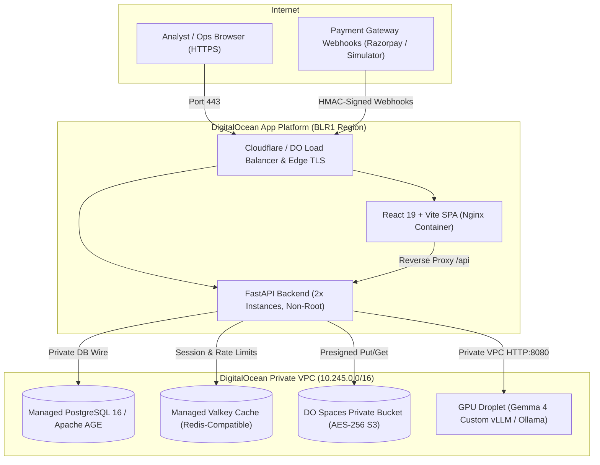

# ResolveX AI — Production Deployment Guide & Runbook

This guide covers deploying, operating, and maintaining ResolveX AI on DigitalOcean in accordance with **PRD §16 (Phase 7)** and `.agents/skills/platform-deployment/SKILL.md`.

---

## 1. Production Architecture Overview



---

## 2. Infrastructure Components

| Component | DigitalOcean Service | Spec / Sizing | Purpose |
|---|---|---|---|
| **API Backend** | App Platform Web Service | `basic-m` (1 vCPU, 2 GB RAM, 2 instances) | FastAPI REST API, LangGraph agent harness, audit logger |
| **Frontend UI** | App Platform Web Service | `basic-xxs` (512 MB RAM, 1 instance) | React 19 Single Page App served via Nginx |
| **Database** | Managed Database Cluster | PostgreSQL 16 (1 Node, 1 GB RAM, 10 GB Storage) | Canonical payment records, cases, approvals, audit ledger |
| **Graph Database** | Self-hosted AGE / Managed | PostgreSQL 16 + Apache AGE Extension | Graph relationship store, Cypher queries, topology |
| **Evidence Vault** | DO Spaces Object Storage | Private S3-compatible bucket (`blr1`) | Encrypted receipts, invoices, PDF statements, audio notes |
| **GPU Inference** | DO GPU Droplet | 1x NVIDIA A10G / H100 (vLLM container) | Open-weight Gemma 4 inference with 0 data exfiltration |

---

## 3. Deployment Runbook

### Step 1: Clone Repository & Configure Secrets
Ensure git remote is set up and environment secrets are ready:
```bash
git clone https://github.com/aaryamanmishra/ResolveX.git
cd ResolveX
```

Set secret environment variables in DigitalOcean App Platform dashboard or CLI:
- `JWT_SECRET_KEY`: High-entropy 64-character secret.
- `RAZORPAY_KEY_ID`: `rzp_test_...`
- `RAZORPAY_KEY_SECRET`: Secret key matching key ID.
- `GEMINI_API_KEY`: (Optional) Google AI Studio API key for multimodal intake.
- `SPACES_ACCESS_KEY` / `SPACES_SECRET_KEY`: Spaces S3 API keys.

### Step 2: Deploy with DigitalOcean App Platform Spec
Apply the production App Platform declaration `infra/digitalocean-app.yaml`:
```bash
doctl apps create --spec infra/digitalocean-app.yaml
```

To update existing deployment:
```bash
doctl apps update <APP_ID> --spec infra/digitalocean-app.yaml
```

### Step 3: Run Database Migrations
Run schema migrations against the managed database:
```bash
doctl apps exec <APP_ID> --component resolvex-api -- python -m backend.migrations.run_migrations
```

### Step 4: Run Deployment Smoke Rehearsal
Verify the live cluster using the automated smoke rehearsal suite:
```bash
API_BASE="https://resolvex-api-xxxx.ondigitalocean.app" \
FRONTEND_BASE="https://resolvex-app-xxxx.ondigitalocean.app" \
./scripts/deploy_smoke_test.sh
```

---

## 4. Disaster Recovery & Backup Runbook

### Database Backups
- DigitalOcean Managed PostgreSQL takes **automated daily backups** with point-in-time recovery (PITR) retained for 7 days.
- Manual snapshot creation via CLI:
  ```bash
  doctl databases create-backup <DATABASE_CLUSTER_ID> --backup-name "resolvex-pre-release-$(date +%F)"
  ```

### Rollback Procedure
If a breaking deployment or regression occurs:
1. **App Platform Rollback**:
   ```bash
   doctl apps list-deployments <APP_ID>
   doctl apps rollback <APP_ID> --deployment <PREVIOUS_HEALTHY_DEPLOYMENT_ID>
   ```
2. **Database Point-in-Time Recovery**:
   Restore cluster to a state prior to incident via DigitalOcean Console -> Databases -> Clusters -> Restore.

---

## 5. Security & Isolation Controls

1. **Zero Financial Writes by LLMs**: Agents produce Pydantic `StructuredInvestigationResult` contracts with proposed next steps, but can never directly call payment provider mutation APIs.
2. **Human Approval Gate (PRD §6 FR-020)**: Any sensitive action (refund draft, priority escalation, legal hold) pauses execution and requires an authenticated supervisor with `SUPERVISOR` or `PLATFORM_ADMIN` role.
3. **Multi-Tenant Scoping**: All database queries, in-memory caches, graph traversals, and object keys are strictly scoped by `tenant_id` and fail closed.
4. **Secret Storage Invariant**: Zero production secrets or test credentials are committed to git; local execution relies on `.gitignore`'d `.env`.
